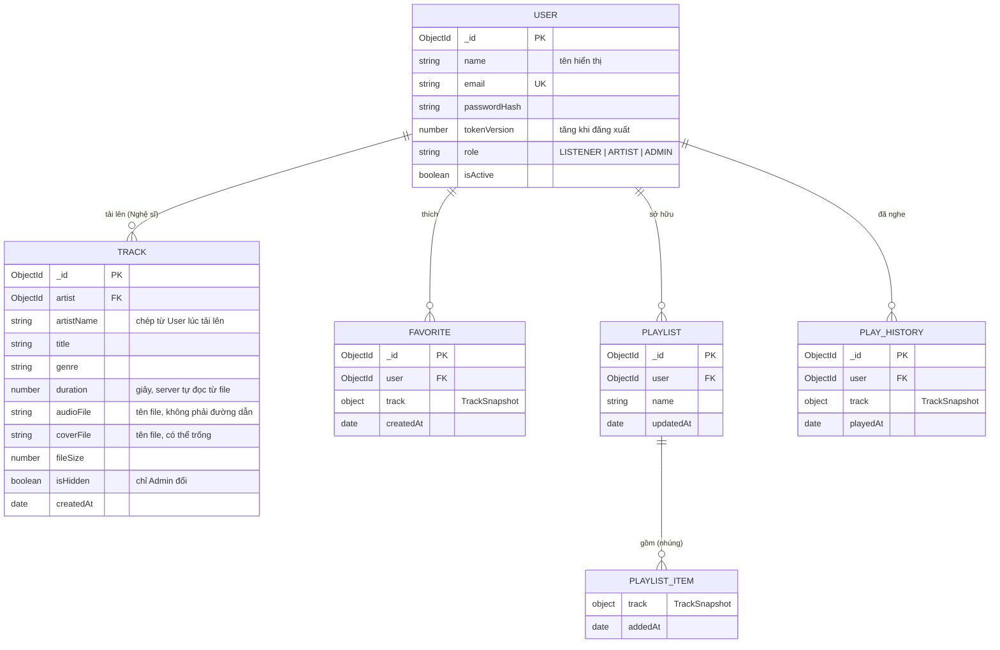
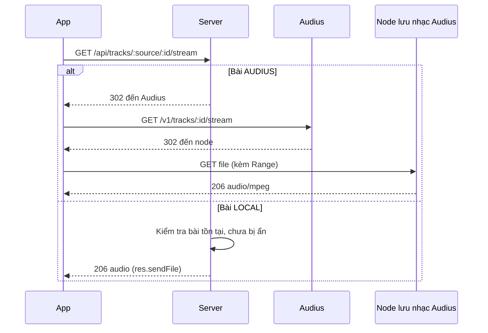
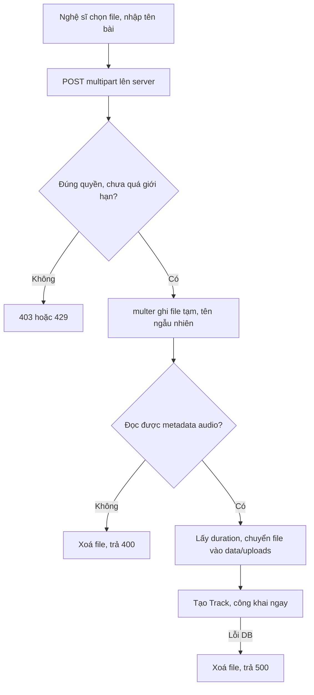

# App nghe nhạc: Context dự án

Ứng dụng di động nghe nhạc trực tuyến, gồm app React Native (Expo) và server Express + MongoDB (bài MMA301, tự chọn đề tài).

**Trạng thái:** server đã có đủ API theo thiết kế. App đã nối với server ở các màn hình Discover, Thư viện (gồm Lịch sử), Tìm kiếm, Tài khoản, Trình phát và hàng đợi, Studio Nghệ sĩ, Quản trị. Mọi mục ghi "Dự kiến" là thiết kế cho client, chưa có code.

Tài liệu liên quan: [client/AGENTS.md](client/AGENTS.md) (quy tắc làm việc với Expo).

## 1. Yêu cầu gốc

- Xây dựng app di động để nghe nhạc trực tuyến, do server Express cung cấp dữ liệu và luồng nhạc.
- Nhạc đến từ một API mã nguồn mở, kết hợp với nhạc do nghệ sĩ trong hệ thống tải lên.
- Người dùng có tài khoản, danh sách yêu thích, playlist cá nhân và lịch sử nghe.
- Trình phát có đầy đủ điều khiển và vẫn phát khi tắt màn hình.
- Có ba vai trò: Người nghe, Nghệ sĩ, Admin. Giao diện bằng tiếng Việt.

## 2. Cấu trúc

Phần có dấu `*` là dự kiến, chưa có trong code.

```text
MMA301_GR2_PR02/
├── context.md
├── server/
│   ├── src/
│   │   ├── index.js        kết nối MongoDB rồi mở cổng
│   │   ├── app.js          cấu hình Express, gắn route
│   │   ├── config.js       URI MongoDB
│   │   ├── lib/validate.js kiểm tra input, phân trang
│   │   ├── models/         User, Track, library (Favorite, Playlist, PlayHistory)
│   │   ├── middleware/     auth (requireAuth, requireRole), rateLimit, upload, error
│   │   ├── routes/         auth, tracks, library, playlists, artist, admin
│   │   └── services/       audius (gọi API ngoài), storage (kiểm tra, lưu, xoá file),
│   │                       tracks (dạng bài hát chung, snapshot)
│   ├── scripts/            seed.js (tạo tài khoản Admin), db-export.js (xuất DB ra migration/)
│   ├── migration/          bản export DB: mỗi collection một file Extended JSON, ghi đè khi chạy npm run db:export
│   ├── data/uploads/       audio/, covers/, tmp/ (git bỏ qua, tự tạo khi chạy)
│   └── test/               kiểm thử bằng node:test
└── client/
    ├── AGENTS.md
    ├── app.json
    └── src/
        ├── app/            màn hình theo Expo Router
        ├── components/     component dùng chung (còn một số file template chưa dùng)
        ├── hooks/          use-auth, use-player, use-fetch
        └── lib/api.ts      wrapper fetch tự gắn token
```

## 3. Vai trò

| Vai trò | Quyền |
|---|---|
| **Khách** (chưa đăng nhập) | Tìm kiếm và nghe nhạc |
| **Người nghe** (`LISTENER`) | Như Khách, thêm yêu thích, playlist, lịch sử nghe |
| **Nghệ sĩ** (`ARTIST`) | Như Người nghe, thêm tải lên, sửa, xoá nhạc của mình |
| **Admin** (`ADMIN`) | Khoá tài khoản, ẩn bài hát, xem thống kê |

- Người dùng tự chọn `LISTENER` hoặc `ARTIST` khi đăng ký, không cần duyệt. Server từ chối giá trị `ADMIN` gửi từ client.
- Tài khoản `ADMIN` chỉ được tạo bằng script seed.

## 4. Chức năng

| Khu vực | Trạng thái | Chức năng |
|---|---|---|
| Tìm kiếm và stream | Có API, chưa có màn hình | Tìm bài ở hai nguồn, lọc bài không stream được, stream có hỗ trợ tua |
| Tài khoản | Có API, chưa có màn hình | Đăng ký, đăng nhập, đăng xuất |
| Trang chủ | Có API, chưa có màn hình | Bài thịnh hành từ Audius, bài mới của nghệ sĩ trong hệ thống |
| Thư viện | Có API, chưa có màn hình | Yêu thích, playlist cá nhân, lịch sử nghe |
| Nghệ sĩ | Có API, chưa có màn hình | Tải bài lên kèm ảnh bìa, sửa thông tin, xoá bài |
| Quản trị | Có API, chưa có màn hình | Khoá, mở tài khoản; ẩn, hiện bài; thống kê số lượng |
| Trình phát | Dự kiến | Phát, dừng, tua, chuyển bài, hàng đợi, mini player, phát nền, điều khiển trên màn hình khoá |

**Không làm:** thanh toán, tải nhạc nghe offline, bình luận, theo dõi nghệ sĩ, chia sẻ playlist công khai, gợi ý nhạc, lời bài hát, shuffle, quên mật khẩu, xác thực email, refresh token, chuyển đổi định dạng audio, bản web.

### Màn hình dự kiến

| Nhóm | Màn hình |
|---|---|
| Tab chính | Trang chủ, Tìm kiếm, Thư viện, Cá nhân |
| Trình phát | Mini player nằm trên thanh tab, màn hình phát toàn bộ, hàng đợi |
| Thư viện | Yêu thích, Lịch sử, danh sách playlist, chi tiết playlist |
| Tài khoản | Đăng nhập, Đăng ký (có chọn vai trò) |
| Nghệ sĩ | Nhạc của tôi, Tải bài lên, Sửa bài |
| Admin | Quản lý người dùng, Quản lý bài hát, Thống kê |

Nghệ sĩ và Admin vào màn hình riêng từ tab Cá nhân. Mọi vai trò dùng chung một app.

## 5. ERD



**`TrackSnapshot`** là object nhúng gồm `source` (`AUDIUS | LOCAL`), `sourceId`, `title`, `artist`, `artwork`, `duration`.

- `TRACK` chỉ chứa bài do nghệ sĩ tải lên. Bài Audius không được chép vào DB, chỉ lưu snapshot khi người dùng thích, thêm vào playlist hoặc nghe.
- Snapshot giúp hiển thị thư viện mà không phải gọi Audius cho từng bài.
- Với bài `LOCAL`, snapshot để trống `artwork`. Server ghép URL ảnh lúc trả response, để DB không dính địa chỉ máy chủ.
- Khoá duy nhất: `FAVORITE` và `PLAY_HISTORY` theo (`user`, `track.source`, `track.sourceId`). Trong một playlist, mỗi bài chỉ xuất hiện một lần.

## 6. Quy tắc nghiệp vụ

### Hai nguồn nhạc

Client dùng chung một dạng bài hát, không cần biết nhạc đến từ đâu ngoài trường `source`:

```json
{
  "source": "AUDIUS",
  "id": "YmJWK",
  "title": "kirbytape mix vol. 13 - lofi house edition",
  "artist": "omgkirby",
  "artwork": "https://.../480x480.jpg",
  "duration": 1690
}
```

- `duration` tính bằng giây. `artwork` có thể là `null`.
- **Tìm kiếm:** trả bài `LOCAL` trước, rồi đến bài Audius. Nếu Audius lỗi, vẫn trả bài `LOCAL` thay vì `502`.
- Tìm bài `LOCAL` theo `title` và `artistName`, không phân biệt hoa thường. Từ khoá phải được escape trước khi đưa vào regex.
- Audius trả `404` khi stream bài có `is_streamable: false`, nên server loại các bài này. Vì lọc sau khi lấy 20 bài, kết quả Audius có thể ít hơn 20.
- Audius trả `400` với id không giải mã được thành bài hát. Server coi trường hợp này là `404`, không phải lỗi nhà cung cấp.

### Stream nhạc



- Đã kiểm tra bằng HTTP client với cả hai nguồn: nhận `206 Partial Content`, `audio/mpeg`. Chưa kiểm tra bằng `expo-audio`.
- `res.sendFile` của Express tự xử lý header `Range`, nên bài `LOCAL` cũng tua được.
- Route stream công khai, vì Khách cũng được nghe.
- Bài `LOCAL` bị ẩn hoặc đã xoá trả `404`.
- **Audio không được mở bằng `express.static`,** nếu không bài bị ẩn vẫn tải được. Chỉ thư mục `covers/` được phục vụ tĩnh.

### Trình phát

Dùng `expo-audio` của SDK 58.

- Một trình phát toàn cục đặt trong `PlayerContext` ở `src/app/_layout.tsx`, nên nhạc không dừng khi chuyển màn hình.
- `expo-audio` có sẵn `createAudioPlaylist`, `useAudioPlaylist` và sự kiện `trackChanged` cho hàng đợi.
- **Nhớ bài đang nghe:** hàng đợi, bài hiện tại và chế độ lặp được lưu vào `AsyncStorage` mỗi khi đổi; vị trí nghe lưu mỗi 5 giây và khi dừng. Mở lại app thì nạp bài cũ ở trạng thái dừng, tua về chỗ đang nghe khi file tải xong, người dùng bấm phát để nghe tiếp. Bài khôi phục mà không phát được thì chỉ báo, bấm phát sẽ chuyển bài. Không dùng `expo-secure-store` vì hàng đợi không phải dữ liệu bí mật và có thể vượt giới hạn kích thước của nó.
- **Phát nền:** bật `enableBackgroundPlayback` trong config plugin (`app.json`), gọi `setAudioModeAsync` với `shouldPlayInBackground: true` và `interruptionMode: 'doNotMix'`.
- **Android bắt buộc gọi `setActiveForLockScreen`.** Tài liệu Expo ghi nếu không bật, nhạc sẽ dừng sau khoảng 3 phút chạy nền. Khi đổi bài thì gọi `updateLockScreenMetadata`.
- Thuộc tính của config plugin chỉ có hiệu lực sau khi build lại app, nên dự kiến dùng **development build**, không dựa vào Expo Go. Tài liệu không nói rõ phát nền có chạy trên Expo Go không.
- Bài lỗi khi phát (ví dụ bị gỡ khỏi Audius) thì báo ngắn gọn rồi chuyển bài tiếp theo.
- Đăng xuất thì dừng nhạc, xoá hàng đợi và xoá luôn bản đã lưu, để người dùng sau không thấy bài của người trước.

### Thư viện cá nhân

- Client chỉ gửi `source` và `id`. Server tự lấy thông tin bài từ DB hoặc Audius để tạo snapshot, không tin dữ liệu bài hát từ client. Không lấy được từ Audius thì trả `502`.
- Mọi truy vấn đều lọc theo `user` lấy từ token. Truy cập playlist của người khác trả `404`.
- **Playlist:** chỉ người tạo thấy, tối đa 200 bài, thứ tự theo lúc thêm, thêm trùng trả `409`. Chưa có đổi thứ tự.
- **Lịch sử:** mỗi người một dòng cho mỗi bài, nghe lại thì cập nhật `playedAt`, giữ 100 bài gần nhất. App ghi lịch sử khi đã nghe 30 giây, hoặc khi bài ngắn hơn phát hết. Khách không có lịch sử.
- Bài `LOCAL` bị ẩn hoặc đã xoá vẫn nằm trong thư viện. Server trả thêm `isAvailable: false`, app làm mờ bài và không cho phát.

### Nghệ sĩ tải nhạc lên

Vì đăng ký nghệ sĩ không cần duyệt và bài công khai ngay, phần này là điểm vào rủi ro nhất của hệ thống.



- Dùng `multer` để nhận file và `music-metadata` để đọc thời lượng. Không tin `mimetype` và tên file do client gửi.
- **Giới hạn:** audio MP3 hoặc M4A, tối đa 20 MB. Ảnh bìa JPG, PNG, WebP, tối đa 5 MB, không bắt buộc. Ảnh được kiểm tra theo magic bytes. Mỗi nghệ sĩ tối đa 50 bài.
- Tên file trên đĩa do server sinh bằng UUID. DB chỉ lưu tên file, không lưu đường dẫn.
- Nghệ sĩ chỉ sửa, xoá được bài của mình. Bài người khác trả `404`. Sửa được `title`, `genre`, ảnh bìa; không thay được file audio.
- Xoá bài: xoá dòng `Track` trước, rồi xoá file. Lỗi khi xoá file chỉ ghi log. Thư viện của người khác không bị dọn, bài hiện là không khả dụng.
- File nằm trên ổ đĩa, nên chỉ chạy được một instance và sau khi clone dự án sẽ không có sẵn nhạc đã tải.

### Quản trị

- Ẩn bài: đặt `isHidden: true`. Bài biến mất khỏi tìm kiếm, trang chủ và không stream được. Nghệ sĩ không tự hiện lại được.
- Khoá tài khoản: đặt `isActive: false`, token hiện tại bị từ chối ngay. Bài của nghệ sĩ bị khoá vẫn công khai, Admin muốn gỡ thì ẩn từng bài.
- Admin không khoá được tài khoản Admin.
- Thống kê chỉ gồm số người dùng theo vai trò, số bài, số bài bị ẩn. Không đếm lượt nghe, vì nhạc Audius không đi qua server.
- **Màn hình** `src/app/admin.tsx`, vào từ thẻ "Quản trị" ở màn hình Tài khoản khi đăng nhập Admin. Có ba tab: Thống kê, Người dùng, Bài hát. Danh sách phân trang 20 mục mỗi trang. Khoá tài khoản và ẩn bài phải bấm hai lần để xác nhận; mở khoá và hiện lại thì làm ngay. Không có nút khoá cho tài khoản Admin. Bấm ảnh bìa để nghe thử bài đang công khai.

### Xác thực bằng JWT

Theo cách đã làm ở bài SDN302.

- Mật khẩu băm bằng `bcrypt`, tối thiểu 8 ký tự.
- Token ký HS256, có `issuer` và `audience`, payload gồm `sub` và `version`. Hết hạn sau 7 ngày, vì app di động không nên bắt đăng nhập lại thường xuyên.
- `requireAuth` tải user từ DB ở mỗi request. Token sai, hết hạn, user bị khoá hoặc `version` lệch đều trả `401`.
- Đăng xuất tăng `tokenVersion`, nên mọi token cũ của tài khoản mất hiệu lực.
- App lưu token bằng `expo-secure-store`, không dùng `AsyncStorage`. Gặp `401` thì xoá token và chuyển về chế độ Khách.
- Đăng nhập, đăng ký giới hạn 15 lần mỗi 15 phút theo IP. Tải nhạc lên giới hạn 20 lần mỗi giờ theo tài khoản. Bộ đếm lưu trong bộ nhớ tiến trình.

### MongoDB

Server không dùng transaction, nên chạy được cả trên MongoDB bản đơn lẫn replica set (máy phát triển hiện chạy replica set `rs0`). Những thao tác trên nhiều nơi phải chịu được lỗi giữa chừng: thư viện coi `Track` không tồn tại là bài không khả dụng.

## 7. API

Lỗi có dạng `{ "error": "<thông báo>" }`, thông báo bằng tiếng Việt để app hiển thị trực tiếp. Route cần đăng nhập nhận header `Authorization: Bearer <token>`.

Danh sách có phân trang nhận `?page=&limit=` (mặc định 1 và 20, `limit` tối đa 100) và trả `{ items, total, page, limit }`. Đăng ký và đăng nhập trả `{ token, user }`.

| Mã | Ý nghĩa |
|---|---|
| `400` | Dữ liệu sai |
| `401` | Chưa đăng nhập hoặc token không hợp lệ |
| `403` | Sai vai trò |
| `404` | Không tồn tại hoặc không thuộc về người gọi |
| `409` | Trùng dữ liệu |
| `429` | Quá giới hạn |
| `502` | Không gọi được Audius |

Tất cả route dưới đây đã có trong code. `:source` là `audius` hoặc `local`.

| Method | Route | Quyền | Mô tả |
|---|---|---|---|
| GET | `/api/health` | Công khai | Trạng thái server và MongoDB |
| GET | `/api/tracks/search?q=` | Công khai | Tối đa 20 bài `LOCAL`, rồi tối đa 20 bài Audius |
| POST | `/api/auth/register` | Công khai | Đăng ký, `role` là `LISTENER` hoặc `ARTIST` |
| POST | `/api/auth/login` | Công khai | Đăng nhập, trả token |
| POST | `/api/auth/logout` | Auth | Tăng `tokenVersion` |
| GET | `/api/me` | Auth | Thông tin tài khoản |
| GET | `/api/tracks/trending` | Công khai | Bài thịnh hành từ Audius |
| GET | `/api/tracks/latest` | Công khai | Bài mới của nghệ sĩ trong hệ thống |
| GET | `/api/tracks/:source/:id/stream` | Công khai | Stream theo nguồn |
| GET | `/api/me/favorites` | Auth | Danh sách yêu thích |
| GET, PUT, DELETE | `/api/me/favorites/:source/:id` | Auth | Kiểm tra trạng thái thích, thích, bỏ thích |
| GET, POST | `/api/playlists` | Auth | Danh sách, tạo playlist |
| GET, PATCH, DELETE | `/api/playlists/:id` | Chủ playlist | Xem, đổi tên, xoá |
| POST | `/api/playlists/:id/tracks` | Chủ playlist | Thêm bài |
| DELETE | `/api/playlists/:id/tracks/:source/:trackId` | Chủ playlist | Bỏ bài |
| GET, POST, DELETE | `/api/me/history` | Auth | Xem, ghi, xoá toàn bộ lịch sử |
| GET, POST | `/api/artist/tracks` | Nghệ sĩ | Bài của tôi; tải bài lên (multipart: `title`, `genre`, `audio`, `cover`) |
| PATCH, DELETE | `/api/artist/tracks/:id` | Chủ bài | Sửa (JSON hoặc multipart: `title`, `genre`, `cover`), xoá bài |
| GET | `/api/admin/users` | Admin | Danh sách người dùng, có phân trang |
| PATCH | `/api/admin/users/:id` | Admin | Đổi `isActive` |
| GET | `/api/admin/tracks` | Admin | Mọi bài `LOCAL`, có phân trang |
| PATCH | `/api/admin/tracks/:id` | Admin | Đổi `isHidden` |
| GET | `/api/admin/stats` | Admin | Thống kê số lượng |

## 8. Chạy dự án

Cần Node.js 24 và MongoDB đang chạy ở cổng 27017.

```bash
# Server: http://localhost:3000
cd server
npm install
cp .env.example .env   # rồi điền JWT_SECRET (tối thiểu 32 ký tự), ADMIN_EMAIL, ADMIN_PASSWORD
npm run db:seed        # tạo tài khoản Admin, chạy lại không đổi tài khoản đã có
npm run dev

# Client
cd client
npm install
npx expo start
```

Cài thư viện cho client bằng `npx expo install <package>`, và đọc tài liệu đúng SDK 58 theo [client/AGENTS.md](client/AGENTS.md).

**Địa chỉ server từ app:** `localhost` không dùng được trên điện thoại hay máy ảo. Điện thoại thật dùng IP LAN của máy chạy server (cùng Wi-Fi), máy ảo Android dùng `10.0.2.2`.

**Development build:** máy phát triển hiện có Java 1.8 và chưa đặt `ANDROID_HOME`, nên chưa thể build Android tại máy. Hoặc cài môi trường Android theo tài liệu Expo rồi chạy `npx expo run:android`, hoặc build trên cloud bằng `npx eas-cli@latest build --profile development`.

**HTTP trong bản build:** app gọi server qua `http://` khi chạy LAN. Bản release trên Android và iOS có thể chặn HTTP, nên cần kiểm tra khi build demo.

## 9. Biến môi trường

| Biến | Nơi dùng | Trạng thái | Ghi chú |
|---|---|---|---|
| `PORT` | Server | Đã có | Mặc định `3000` |
| `MONGODB_URI` | Server | Đã có | Mặc định `mongodb://127.0.0.1:27017/mma301_music` |
| `JWT_SECRET` | Server | Đã có | Bắt buộc, tối thiểu 32 ký tự. Thiếu thì server không khởi động |
| `ADMIN_EMAIL`, `ADMIN_PASSWORD` | Script seed | Đã có | Tạo tài khoản Admin |
| `UPLOAD_DIR` | Server | Đã có | Không bắt buộc, mặc định `server/data/uploads` |
| `EXPO_PUBLIC_API_URL` | Client | Đã có | Không bắt buộc, mặc định cổng 3000 trên máy đang chạy `expo start`. Biến `EXPO_PUBLIC_*` nằm trong bundle, không đặt bí mật ở đây |

Chưa dùng API key của Audius. Key miễn phí và cho hạn mức cao hơn; nếu cần thì thêm ở server, không đưa vào client, và lưu ý route stream Audius hiện chuyển hướng thẳng cho client nên không gắn key vào đó được.

Xem mẫu ở [server/.env.example](server/.env.example). File `.env` không được commit.

## 10. Kiểm thử

- `npm test` trong `server/`: 45 test bằng `node:test`, gồm xác thực, phân quyền, thư viện, tải nhạc, quản trị, stream. Tất cả đang pass. Test cần MongoDB ở cổng 27017, tự tạo và xoá database riêng, và giả lập Audius nên không cần mạng.
- Đã chạy thử toàn bộ luồng trên server thật với MongoDB và Audius thật: đăng ký, seed Admin, thịnh hành, tải nhạc, tìm kiếm, stream hai nguồn, yêu thích, playlist, lịch sử, ẩn bài, thống kê, xoá bài, đăng xuất.
- File M4A chưa được kiểm thử, test chỉ dùng MP3.
- Client: `npx expo-doctor` pass 20/20, `npx expo export --platform android` build được.
- `npx tsc --noEmit` trong `client/` không báo lỗi. ESLint còn 1 lỗi trong code template: `src/hooks/use-color-scheme.web.ts:11`.
- Đã chạy thử app trên bản web với server thật, MongoDB và Audius thật: nghe nhạc hai nguồn, tua, đăng ký, đăng nhập, yêu thích, playlist, tìm kiếm, lịch sử, bài không khả dụng, hết phiên, đăng xuất.
- Chưa chạy app trên máy ảo hay điện thoại. Chưa kiểm thử phát nền và màn hình khoá.

## 11. Giới hạn đã biết

- **Audius là dịch vụ ngoài:** mất mạng hoặc bị giới hạn tần suất thì không tìm và nghe được bài Audius. Hạn mức khi không có key chưa rõ.
- **Bản quyền nhạc Audius:** nhiều bài ghi "All rights reserved". Chỉ stream qua API, không tải về hay phát hành lại.
- **Tìm kiếm tiếng Việt:** regex phân biệt dấu, nên "son tung" không tìm ra "Sơn Tùng" trong bài `LOCAL`.
- **CORS:** server cho phép mọi origin, vì xác thực bằng header Bearer chứ không dùng cookie. `expo start --web` gọi được API. Bản web chỉ để thử nhanh và không giữ đăng nhập sau khi tải lại trang, vì `expo-secure-store` không hỗ trợ web.
- **Git:** một repo chung ở thư mục gốc, `main` là nhánh mặc định, code nằm trên `development`.
- **Bản export DB:** `server/migration/users.json` chứa email và mật khẩu đã băm, nên repo phải để private. Muốn public thì phải bỏ file này khỏi cả lịch sử git trước.
- **OneDrive:** dự án nằm trong thư mục OneDrive, việc đồng bộ `node_modules` và `data/uploads` có thể làm chậm hoặc gây khoá file.

## 12. Quyết định đã chốt và phần tạm chốt

**Đã chốt theo yêu cầu dự án:** đề tài tự chọn; có tài khoản, yêu thích, playlist, lịch sử; ba vai trò; trình phát đầy đủ có phát nền; lưu audio trên ổ đĩa server; tự chọn vai trò Nghệ sĩ khi đăng ký; bài công khai ngay và Admin ẩn được; giao diện tiếng Việt.

**Tạm chốt khi viết thiết kế, có thể đổi:**

| Nội dung | Tạm chốt | Lý do |
|---|---|---|
| Nguồn nhạc ngoài | Audius | Tìm kiếm và stream không cần key; Jamendo bắt buộc có `client_id` |
| Stream bài Audius | Redirect, không proxy | Server không tốn băng thông. Muốn kiểm soát hoặc đếm lượt nghe thì đổi sang proxy |
| Khách | Được tìm và nghe | Dùng thử trước khi đăng ký |
| Quyền Admin | Khoá tài khoản, ẩn bài, thống kê | Đủ việc quản trị khi không có bước duyệt |
| Nền tảng demo | Ưu tiên Android | Máy phát triển là Windows |
| Giới hạn số | 20 MB, 5 MB, 50 bài, 200 bài mỗi playlist, 100 dòng lịch sử, token 7 ngày | Giá trị khởi đầu cho quy mô bài tập |
| Thư viện | Server: `multer`, `music-metadata`, `bcrypt`, `jsonwebtoken`. Client: `expo-audio`, `expo-secure-store`, `@react-native-async-storage/async-storage` | Đã cài |

## 13. Câu hỏi còn mở

1. **Có cần xác nhận bản quyền khi nghệ sĩ tải nhạc không?** Hiện ai cũng đăng ký Nghệ sĩ và đăng bài ngay được, nên có thể xuất hiện nhạc vi phạm. Cách nhỏ nhất là thêm ô xác nhận khi tải lên.
2. **Người nghe có được nâng lên Nghệ sĩ không?** Vai trò hiện chỉ chọn lúc đăng ký. Nếu cần thì thêm một nút ở màn hình Cá nhân.
3. **Có deploy lên hosting không?** Nếu có, phải chọn hosting có ổ đĩa lâu dài, hoặc chuyển audio sang nơi lưu riêng như S3 hay Cloudinary. HTTPS cũng phải có.
4. **Demo trên thiết bị nào?** Nếu có iOS, development build cần tài khoản Apple Developer và build qua EAS.
5. **Phát nền có chạy trên Expo Go không?** Tài liệu không nói rõ. Cần thử sớm, vì nếu chạy được thì chưa cần cài môi trường build Android.

## 14. Tài liệu tham khảo

- [Audius API](https://docs.audius.co/api)
- [Audius: stream track](https://docs.audius.co/developers/api/stream-track)
- [Audius SDK](https://docs.audius.co/sdk)
- [Expo Audio, SDK 58](https://docs.expo.dev/versions/v58.0.0/sdk/audio/)
- [Expo: development build](https://docs.expo.dev/develop/development-builds/introduction/)
- [Jamendo API](https://developer.jamendo.com/v3.0/tracks) (phương án thay thế)
